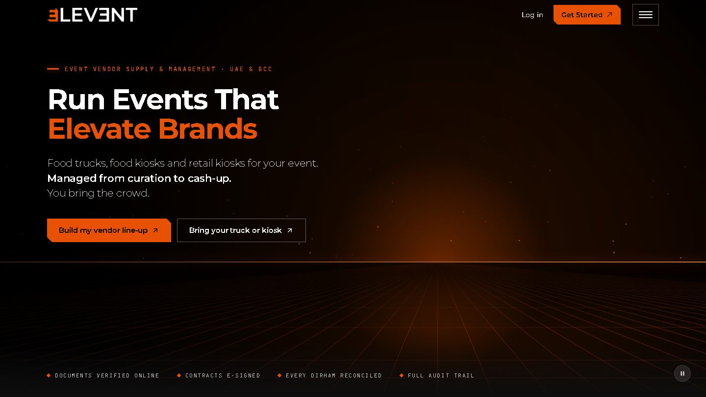
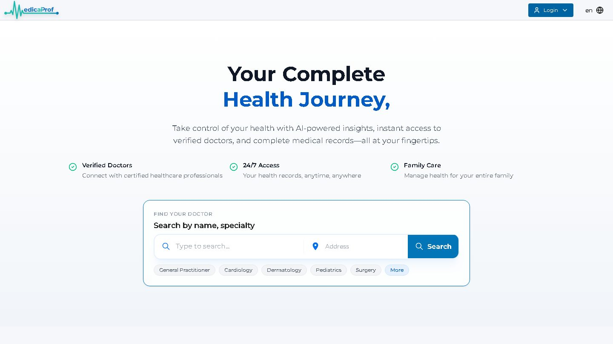
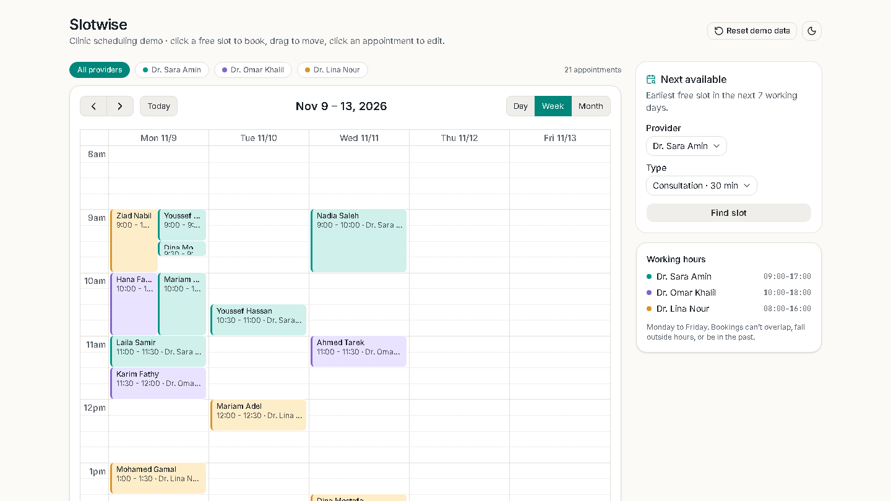
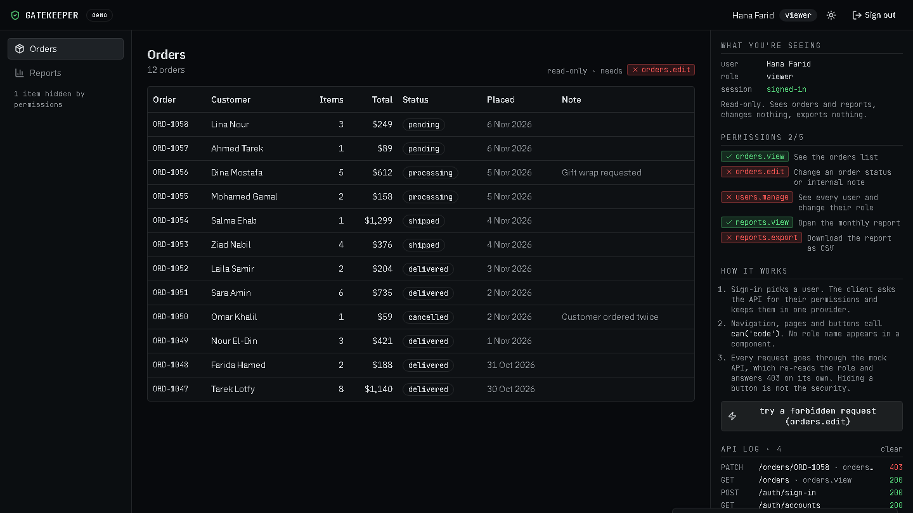
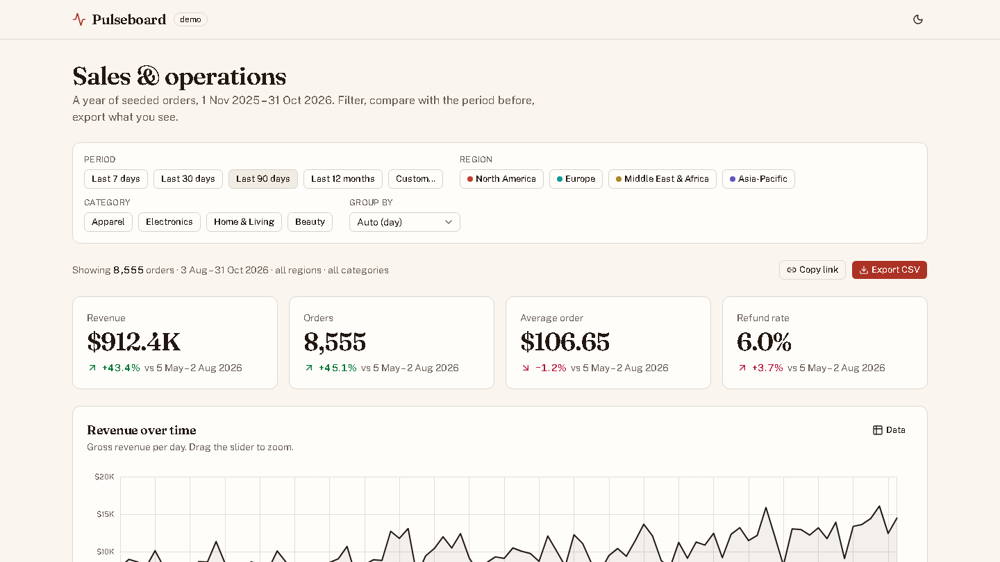
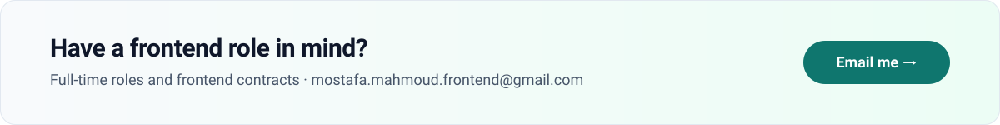

<picture>
  <source media="(prefers-color-scheme: dark)" srcset="assets/header-dark.svg">
  
</picture>

  &nbsp;
  &nbsp;
  &nbsp;
  

## In production

<table>
  <tr>
    <td width="50%" valign="top">
      
      
<strong>Elevent</strong> · live event-operations platform · <em>sole developer</em> 
      One platform for the whole vendor lifecycle at UAE events: onboarding and document checks, contracts, on-site operations, POS sales, reconciliation and payouts. I built the frontend end to end (120+ pages, 7 user types, 13 roles, 45 permissions), then shipped and operate the full product. Live since October 2026.

      
<a href="https://elevent.ae/">elevent.ae</a> · <a href="https://portfolio-v2-7p0.pages.dev/work/elevent">Case study</a>

    </td>
    <td width="50%" valign="top">
      
      
<strong>MedicaProf</strong> · production healthcare platform · <em>frontend developer</em> 
      Appointment scheduling and analytics for patients and doctors. In a small cross-functional team I built the appointment calendar (FullCalendar), the analytics dashboards (Apache ECharts) and the shared component library the screens are assembled from.

      
<a href="https://medicaprof.com/en">medicaprof.com</a>

    </td>
  </tr>
</table>

## Open source, so the work can be read

Elevent and MedicaProf are private codebases. These three small, finished apps each mirror a feature I built in production, and share one standard: Next.js 15 and TypeScript, unit and end-to-end tests, GitHub Actions on every push, a README that explains the key decisions, and a live deployment on Cloudflare Pages.

<table>
  <tr>
    <td width="33%" valign="top">
      
      
<strong>Slotwise</strong> · appointment scheduling 
      Week, day and month views, drag to move and resize, overlap and working-hours rules in pure tested functions, and a next-free-slot finder. Mirrors the calendar work on MedicaProf.

      
<a href="https://slotwise-d21.pages.dev">Live demo</a> · <a href="https://github.com/Mostafa3ta/slotwise">Source</a>

    </td>
    <td width="33%" valign="top">
      
      
<strong>Gatekeeper</strong> · role-based access control 
      Three roles, one permission catalog, a UI that hides what you can't do and a mock API that refuses it anyway. Mirrors the permission system I designed for Elevent.

      
<a href="https://gatekeeper-demo.pages.dev">Live demo</a> · <a href="https://github.com/Mostafa3ta/gatekeeper-demo">Source</a>

    </td>
    <td width="33%" valign="top">
      
      
<strong>Pulseboard</strong> · analytics dashboard 
      KPI tiles with period-over-period change, four Apache ECharts charts, filters that live in the URL so any view can be shared, and CSV export. Mirrors the dashboards I built for MedicaProf.

      
<a href="https://pulseboard-enb.pages.dev">Live demo</a> · <a href="https://github.com/Mostafa3ta/pulseboard">Source</a>

    </td>
  </tr>
</table>

## Stack

**Frontend**&nbsp;       

**Testing**&nbsp;   

**Tooling**&nbsp;   

 

<a href="mailto:mostafa.mahmoud.frontend@gmail.com">
  <picture>
    <source media="(prefers-color-scheme: dark)" srcset="assets/contact-dark.svg">
    
  </picture>
</a>
